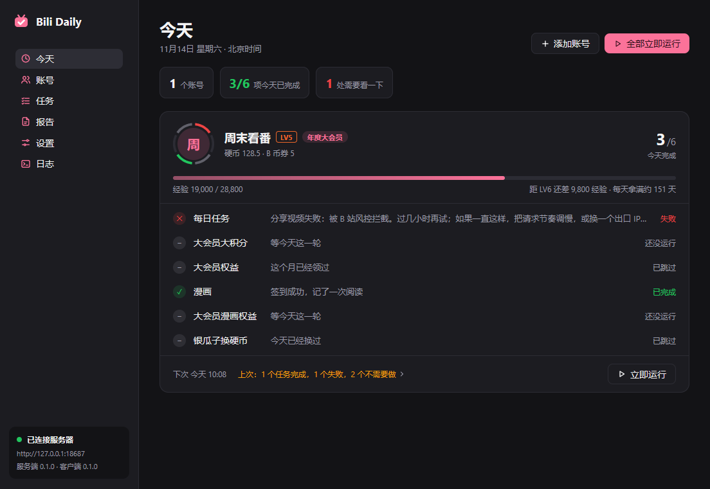
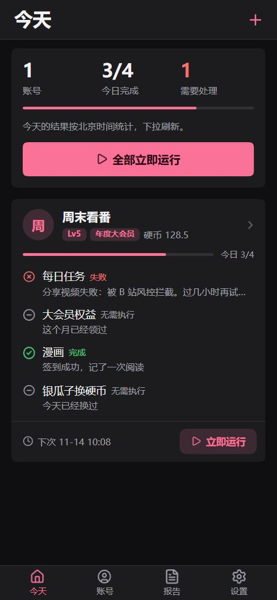

<div align="center">


# Bili Daily

**B 站日常，到点做完。**

签到、投币、大会员积分、漫画、银瓜子，每天到点给每个账号跑一轮。<br>
哪一步没成，报告里写着为什么、该怎么办。

[](https://github.com/VOfficial404/bili-daily/releases/latest)
[](https://github.com/VOfficial404/bili-daily/actions/workflows/ci.yml)
[](LICENSE)

**[项目主页](https://vofficial404.github.io/bili-daily/)** · [下载](https://github.com/VOfficial404/bili-daily/releases/latest) · [四行命令开始](#四行命令就能开始) · [先读这些](#用之前先读这些)

</div>

<table>
  <tr>
    <td width="68%"></td>
    <td></td>
  </tr>
</table>

## 该做的，每天都做完

- **一天，只跑一轮。** 只设一个开始时间，到点后依次做完开着的任务。错过了，开机就补。
- **失败了，也说得明白。** 每一轮留一份报告，失败的那一步写着原因和办法。报告默认保留 30 天，可在设置里调整，每账号最多留 60 份。
- **不会重复投币。** 每个任务先查 B 站今天做过没有，多跑几轮也只做还没做的。
- **扫一下，就添加好。** 用 B 站 App 扫码添加账号，Cookie 快过期时自己续期。
- **花钱的事，先问你。** 充电、粉丝牌、天选时刻默认关着，打开前会让你确认。
- **账号，只在你手里。** 凭据和报告都存在你自己的服务器上，这个项目不收集任何数据。

填优先投币的 UP 主或充电对象 UID 时，会显示头像、昵称和 UID，方便核对；查不到资料也不会改掉你填的 UID。

## 在哪看，都一样

三个入口连着同一个服务端，一处改了，另外两处马上看到。

| | |
|---|---|
| **网页面板** | 服务端自带。浏览器打开服务器地址，用令牌登录 |
| **桌面客户端** | Windows、macOS 与 Linux。没有服务器，也能直接在本机跑 |
| **手机 App** | Android 与 iOS。出门在外看一眼，失效了就地重新扫码 |

挑你的设备下载：[Releases](https://github.com/VOfficial404/bili-daily/releases/latest) 页面写着每种设备该下哪个文件。

## 四行命令，就能开始

一台装了 Docker 的 Linux 服务器就够：

```bash
mkdir -p /opt/bili-daily && cd /opt/bili-daily
curl -fsSLO https://raw.githubusercontent.com/VOfficial404/bili-daily/main/compose.yaml
docker compose up -d
docker compose exec bili-daily bili-daily token   # 登录用的令牌
```

浏览器打开 `http://127.0.0.1:8686`，粘贴令牌，扫码添加账号。添加后马上跑第一轮，以后每天北京时间 09:30 起自己跑。更新只要 `docker compose pull && docker compose up -d`。

> [!IMPORTANT]
> 服务端默认只听本机。要从别的设备访问，用 SSH 隧道或 HTTPS 反向代理，**别把明文端口开到公网**：拿到令牌，就能操作你的账号。

<details>
<summary><b>从别的电脑或手机访问</b></summary>

- **SSH 隧道**：在自己电脑上保持运行 `ssh -N -L 8686:127.0.0.1:8686 root@服务器IP`，再打开 `http://127.0.0.1:8686`。
- **HTTPS 反向代理**（有域名时，手机用它），例如 Caddy：

  ```
  bili.example.com {
      reverse_proxy 127.0.0.1:8686
  }
  ```

</details>

<details>
<summary><b>不用 Docker</b></summary>

```bash
curl -fsSL https://raw.githubusercontent.com/VOfficial404/bili-daily/main/scripts/install.sh | sudo sh
```

装到 `/opt/bili-daily`，注册成 systemd 服务；再跑一次就是更新。也可以下载 `bili-daily_<系统>_<架构>` 自己运行：

| 命令 | 做什么 |
|---|---|
| `bili-daily` | 常驻运行，提供网页面板和接口 |
| `bili-daily login` | 在终端里扫码添加账号 |
| `bili-daily run` | 立即跑一轮然后退出，可以交给 cron |
| `bili-daily token` | 显示令牌 |

| 环境变量 | 默认 | 说明 |
|---|---|---|
| `BILI_DAILY_DATA` | 程序旁边的 `data` | 数据目录 |
| `BILI_DAILY_ADDR` | `127.0.0.1:8686` | 监听地址 |
| `BILI_DAILY_TOKEN` | 自动生成 | 令牌 |

</details>

## 花钱的，默认不做

| 默认开 | 默认关 |
|---|---|
| **每日任务**：看视频、分享、投币 | **B 币券充电**：每月充给指定的 UP 主 |
| **大会员大积分**：签到和浏览任务 ¹ | **粉丝牌**：点赞、发弹幕、挂时长 |
| **大会员权益**：每月的 B 币券和优惠券 ² | **天选时刻**：按奖品名筛选抽奖 |
| **漫画**：签到，记一次阅读 | **批量取关**：只在你点运行时 |
| **大会员漫画权益**：每月的漫读券 ¹ | |
| **银瓜子换硬币**：每天一次 | |

¹ 需要大会员。² 需要有效的年度大会员；B 币券充电也会检查年度资格，不符合就自动跳过。观看正片会领取任务并提示到官方 App 连续观看 10 分钟，本工具不会把领取当作观看完成。

跑完的结果可以推送到 Telegram、企业微信、钉钉、Bark、PushPlus、Server 酱或自定义 Webhook。

<details>
<summary><b>没跑成，怎么办</b></summary>

打开那一轮的报告，失败的那一步写着原因和建议。常见的几种：

| 报告里写着 | 怎么办 |
|---|---|
| 登录失效 | 重新扫码。Cookie 平时会自己续期，被踢下线或改了密码才需要 |
| 被风控拦截 | 过几小时再试；常出现就把请求节奏调慢，或者换个出口 IP |
| 网络不通 | 检查网络和代理。每日计划会隔 30 分钟重试，一天最多 3 次 |
| 接口可能变了 | 更新到最新版；还是不行就提 issue，附上报告里那一步 |

不满足条件的（不是大会员、今天已经做过）记作「跳过」，不算失败。

</details>

## 想改代码

需要 Go 1.27 或更新。结构、接口和每日计划的规则，写在[设计文档](docs/DESIGN.md)里。

```bash
go test ./...                                               # 服务端和引擎
go build ./cmd/bili-daily                                   # 服务端，网页面板已经嵌进去
(cd app && go tool mygo build)                              # 桌面客户端
(cd mobile && go tool nsgo build -target android_arm64)     # Android
(cd mobile && go tool nsgo build -target ios)               # iOS，需要 macOS 和 Xcode
```

桌面客户端用 [MyGo](https://mygo.run) 写成。等 MyGo 的手机支持合并（[egoist/mygo#940](https://github.com/egoist/mygo/pull/940)），手机 App 也会搬进 `app/`，和桌面共用一套代码；在那之前，手机 App 暂时用 [NSGo](https://github.com/nsgo-dev/nsgo)。迁移的步骤见设计文档。

## 用之前，先读这些

> [!WARNING]
> 本项目与哔哩哔哩官方无关。它调用 B 站的非公开接口，可能触发风控，也不符合 B 站的用户协议；投币和充电会花掉虚拟财产，而且撤不回。后果由使用者自行承担。完整的[免责声明](https://vofficial404.github.io/bili-daily/#disclaimer)在项目主页上。

功能参考了 [BiliBiliToolPro](https://github.com/RayWangQvQ/BiliBiliToolPro)（实现独立），接口资料来自 [bilibili-API-collect](https://github.com/SocialSisterYi/bilibili-API-collect)。以 [MIT](LICENSE) 许可开源。
