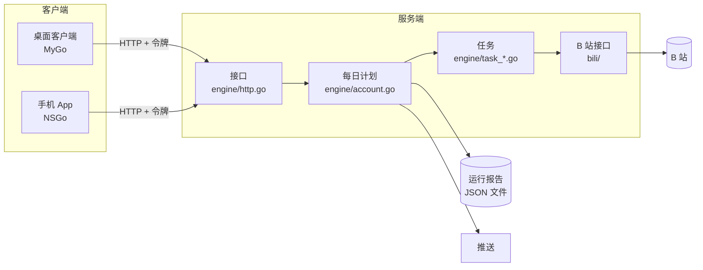

# 设计

bili-daily 定时替 B 站账号完成每日任务。功能参考 [BiliBiliToolPro](https://github.com/RayWangQvQ/BiliBiliToolPro)，实现是独立的：没有使用它的代码，只参考了它用到的 B 站接口（整理在 [research/](research/) 里）。

## 和 BiliBiliToolPro 的区别

| | BiliBiliToolPro | bili-daily |
|---|---|---|
| 排程 | 每个任务一条 cron，十几条各跑各的 | 每个账号每天一轮：到点依次做完所有开着的任务。只需要设一个开始时间 |
| 配置 | 配置文件、环境变量、面板数据库三处，每个任务一组选项 | 一份设置，扫码之后不改任何东西就能用；每个任务只留真正需要决定的几项 |
| 界面 | 服务器上的网页面板 | 没有网页。桌面和手机上的原生客户端，通过接口连服务端 |
| 失败时 | 日志、执行记录与失败汇总 | 每一轮有一份分步报告，直接显示失败原因和处理建议 |
| 部署 | .NET 主机、SQLite、Quartz，或青龙面板 | 一个可执行文件，数据是几个 JSON 文件 |
| 没有服务器 | 可以在本机运行 Console 主机 | 客户端直接选择「在本机运行」，同一个引擎编进桌面和手机 App |
| Cookie | 过期后重新扫码 | 保存 refresh_token，B 站提示该刷新时自动换新 |

## 结构



服务端是一个 Go 包（`engine`），三种用法是同一份代码：

- **服务器**：`cmd/bili-daily` 把它包成命令行程序，常驻运行。
- **桌面客户端的本机运行**：客户端在自己的进程里启动 `engine`，接口只监听 `127.0.0.1` 的随机端口，令牌保存在本机数据目录，界面像连服务器一样连过去。
- **手机 App 的本机运行**：同上。手机系统可能暂停或结束后台进程，本机任务只有在 App 打开时可靠运行。回到前台时调用 `Engine.Wake()` 重新检查并补跑；后台保留引擎和二维码，避免切换到 B 站后丢失扫码会话。稳定定时推荐连服务器。

客户端连服务器和连本机走的是同一套接口，所以界面只有一份逻辑。

`client.Session` 统一连接、本机引擎启停、设置保存和状态刷新：保存前从服务器取最新设置并做三方合并；保存之前发出的刷新不能覆盖已保存设置。停止本机引擎会等待关闭完成，监听器在返回本机地址之前已登记，立即停止也不会留下端口。

### 为什么服务端不用 Gojo

按本项目的跨平台本机运行要求评估 [Gojo](https://gojo.egoist.dev)，最终选择 Go：

- Gojo 只支持 macOS 和 Linux，不支持 Windows，也不能编进 Android 和 iOS 的 App。「在本机运行」在 Windows 和手机上就没法做，除非把每个任务用 Go 再写一遍。
- 它是 v0.0.1 的实验性语言：标准库的 HTTP 客户端不能设代理，`crypto` 里没有 RSA（刷新 Cookie 要用），TLS 依赖系统里的 OpenSSL。
- 桌面客户端（MyGo）和手机 App（NSGo）本来就是 Go。服务端也用 Go，引擎可以直接编进客户端。

## 目录

```
api/              接口的数据类型和 Go 客户端，服务端和客户端共用
client/           客户端共用的连接、本机引擎、设置合并与展示逻辑；不依赖界面库
bili/             B 站接口：发请求、签名、登录，以及各任务用到的接口。不保存任何东西
bili/bilitest/    测试用的假 B 站
engine/           服务端：账号、每日计划、任务、运行报告、推送、接口
cmd/bili-daily/   服务器上的命令行程序
web/              服务器自带的网页面板：嵌进程序的静态页面（无构建步骤的原生 JS），通过 /api 取数据
app/              MyGo 客户端（单独的 Go 模块）；目前用于桌面，窄窗口已有紧凑布局，后续接入手机端
mobile/           过渡期的 NSGo 手机 App（单独的 Go 模块）
scripts/          服务器的安装脚本
site/             项目主页（GitHub Pages）；图标和截图在发布时从 web/static 和 docs/images 拷入
internal/icongen/ 画应用图标的小程序，桌面、托盘和手机的图标都由它生成
docs/research/    整理的 B 站接口资料，和 NSGo 可行性的记录
```

`app` 和 `mobile` 是单独的 Go 模块，用 `replace` 指向上一级目录：这样服务端的 `go.mod` 里没有界面库。

### 迁移到 MyGo 手机端

目标是让桌面和手机共用 `app/` 一套 MyGo 界面，减少两份界面的维护。现在已把连接、本机引擎生命周期、设置合并与展示辅助逻辑放到无界面依赖的 `client` 包；`app/` 的紧凑布局已用于窄窗口。令牌通过 `mygo.Secrets` 保存，手机支持落地后由它映射到 iOS Keychain / Android Keystore。

[MyGo PR #940](https://github.com/egoist/mygo/pull/940) 合并并发布后，具体迁移步骤：

1. 在 `app/` 增加 iOS / Android 平台入口，用同一模块执行 `mygo build -platform ios` 或 `mygo build -platform android`；桌面托盘和关闭到托盘逻辑留在桌面文件。
2. 用 `ui/mobile` 的栏和 sheet 适配手机布局，处理安全区域、键盘与页面前进返回（`Window.Push/Pop`）。
3. 为本机引擎接入 `plugins/background`，保留前台唤醒补跑，并在真机验证切换到 B 站扫码和后台恢复。
4. 完成真机验证后删除 `mobile/` 及 NSGo 依赖，更新 CI 和发布流程，统一从 `app/` 生成各平台产物。

风险：该 PR 尚未合并，当前不依赖其中任何 API，NSGo 手机端继续工作；PR 说明 Android 尚未在设备上测试，后台执行和系统生命周期需要特别验证。

## 每日计划

- 每个账号每天跑一轮。开始时间是设置里的 `run_at`（**北京时间**，和服务器时区无关：B 站按北京时间算「每天」），再推迟 0~`jitter` 分钟，但不会跨过当天 23:59:59。推迟多少由账号和日期算出来，所以每个账号每天都不同，重启之后不变。
- 到点时程序没在运行（服务器重启、电脑关机），启动后立即补跑。新加的账号也是这样：扫完码马上跑第一轮。
- 一轮里先检查登录（顺便每天问一次 Cookie 是否该刷新），然后按固定顺序做任务，最后再取一次资料。
- 每日观看、分享、投币和可查询的权益先看 B 站状态再动手，避免重复花币；没有查询接口的漫画月度权益用本地月份记录。漫画阅读提交的是历史记录，直播和抽奖则受本轮预算限制，不宣称所有请求都有服务端幂等保证。
- 连登录检查都因为网络不通没过时，30 分钟后重试，一天最多 3 次。其他失败不自动重试：风控之类的重试只会更糟。
- 天选时刻可以按自己的间隔（默认 6 小时）在每日计划之外单独再跑。
- 登录失效的账号不再排程，重新扫码之后恢复。

Cookie 刷新得到新会话后，先把 Cookie 和 refresh_token 一起写入会话文件，再向 B 站确认使旧会话失效。保存失败时不作废旧凭据；确认失败时保留已经保存的新凭据。退出账号会先拒绝新运行并等待当前任务结束，再注销和删除数据。

## 任务

| ID | 名字 | 默认 | 条件 |
|---|---|---|---|
| `daily` | 每日任务：看视频、分享、投币 | 开，每天投 5 个币，6 级之后不投 | |
| `vip_point` | 大会员大积分 | 开 | 大会员 |
| `vip_privilege` | 领年度大会员每月权益（B 币券、优惠券等） | 开 | 有效年度大会员 |
| `charge` | B 币券充电 | 关（要先填给谁充） | 有效年度大会员，且有至少 2 个 B 币券 |
| `manga` | 漫画签到和阅读 | 开 | |
| `manga_privilege` | 大会员漫画权益 | 开 | 大会员 |
| `silver2coin` | 银瓜子换硬币 | 开 | |
| `fans_medal` | 粉丝牌：点赞、弹幕、观看 | 关（会在别人直播间里留下痕迹） | |
| `live_lottery` | 天选时刻抽奖 | 关（会关注陌生主播） | |
| `unfollow` | 批量取关一个分组 | 只能手动运行 | |

投币前检查 `buvid3`：扫码登录时可能没取到设备 Cookie，缺失时从设备接口补取并保存到原会话；已有标识不更换，刷新凭据和其他 Cookie 不覆盖。补取或保存失败时不发投币请求。该要求见[接口资料镜像](https://github.com/bilibili-plugins/bilibili-api-collect/blob/master/docs/video/action.md#投币视频web端)；Cookie 存在不保证 B 站接受这次操作。

每次实际发出投币请求前额外随机等待一段时间（首枚也等待），默认 20–40 秒，可在每日任务设置里改为 0–600 秒之间的任意范围（`coin_delay_min`、`coin_delay_max`，都为 0 表示不额外等待）；普通请求仍遵循所选节奏；跳过自己的视频或已投满的视频时不额外等待。日志记录等待秒数，等待期间中止运行不再发出该次投币请求，并保留此前成功数量。延迟只减少操作密度，不保证解除风控。

`coin/add` 返回 `-403 账号异常` 时立即停止本轮投币，保留此前成功的数量，不自动重试。报告提示先核对官方 App 状态和服务器会话，不把该错误直接归因于频率或 IP。官方 App 正常与服务器请求被拒绝可以同时发生；补齐缺失的设备 Cookie 也不保证解除限制。

账号不满足条件时任务记为「跳过」，不算失败。每个账号可以单独关掉某些任务。

领取月度权益和 B 币券充电要求有效年度大会员，月度会员仍可签到和做适用的积分任务、领适用的漫画权益。过期的年度会员不算年度资格。B 币券充电在支付前重新核对资格和余额。不根据未确认含义的任务元数据枚举扩大年度限制。

观看正片的任务领取使用现有客户端元数据（包括 `build`），修复领取请求遗漏参数导致的 `6007000`。领取成功不等于观看完成：本工具不实现真实播放，报告明确提示到官方 App 连续观看 10 分钟；不再调用不适用的通用完成接口。其他任务仍在提交后重新查询状态核对，真实领取错误保留原 code。

### 怎么写一个任务

一个任务是 `engine/task_<名字>.go` 里的一个 `Task`，在 `init` 里 `register`；用到的 B 站接口写成 `bili` 包里 `*Client` 的方法。参考 [engine/task_unfollow.go](../engine/task_unfollow.go) 和它的测试。

```go
func init() {
    register(Task{
        Info:    api.TaskInfo{ID: TaskManga, Title: "漫画", Desc: "…", Group: "漫画"},
        Enabled: func(s *api.Settings) bool { return s.Tasks.Manga.Enabled },
        Run:     runManga,
    })
}
```

`Run` 拿到一个 `*Ctx`（定义在 [engine/task.go](../engine/task.go)），不返回错误，而是把做了什么一步步记下来：

- `x.OK(名字, 说明)`：这一步做成了。
- `x.Skip(名字, 说明)`：不需要做（今天已经做过、设置里关着、账号不满足条件）。B 站返回「已经领过」之类的 code 也记成 Skip。
- `x.Fail(名字, err)`：失败。原因和建议由 `bili.Classify(err)` 归类。
- `x.Failf(名字, 原因, 说明)`：失败，原因由任务自己判断。
- `x.Note(…)`：任务的一句话结果，显示在任务列表和推送里，例如「经验 +15，投币 5 个」。
- `x.Aborted()`：运行被中止或登录失效，任务应该尽快返回。`x.Sleep(d)` 在被中止时返回 false。
- `x.C` 是账号的 `*bili.Client`，`x.Nav` 是这一轮开始时的账号资料，`x.Set` 是设置，`x.Mid`、`x.Day` 是 UID 和今天的日期。`x` 本身是 `context.Context`。
- `x.Mark` / `x.SetMark` 在账号上记一个值（例如这个月已经充过电）。能从 B 站查到的状态不要记在本地。

规则：

- 一步失败不要直接返回，除非后面的步骤依赖它；其他步骤照常做。
- 先查状态再动手，让任务可以重复运行。
- 步骤的名字和说明是给用户看的中文，说清楚做了什么、得到什么。
- 请求之间的间隔由引擎统一控制（`pace` 设置），任务里只在协议要求时另外等待。
- 测试用 `bilitest` 的假 B 站和 `engine/helpers_test.go` 里的 `newEnv`、`login`、`runTask`，检查发出去的请求和报告里的结果。

## 运行报告

每一轮保存一份报告（`api.Run`）：登录检查和每个任务各一项，每项里是各个步骤。任务的结果由步骤算出来：有失败也有成功是「部分完成」，只有失败是「失败」，只有跳过是「跳过」。

失败的步骤带一个原因类别和对应的建议：

| 原因 | 含义 | 建议 |
|---|---|---|
| `not_login` | 登录失效（-101、-111） | 重新扫码 |
| `risk` | 被风控拦截（-352、-412、-403） | 过几小时再试；把请求节奏调慢，或换出口 IP |
| `rate` | 请求太频繁（-509、-799） | 会自动恢复；把请求节奏调慢 |
| `ineligible` | 账号不满足条件 | |
| `insufficient` | 硬币、B 币券等不够 | |
| `network` | 网络或代理不通 | 检查网络和代理设置 |
| `changed` | 响应不是预期的格式 | 更新到最新版本 |
| `canceled` | 运行被中止 | |
| `other` | 其他，说明里是 B 站返回的原话 | |

报告默认保留 30 天，可在各端设置为 1～365 天；同时每个账号最多保留最近 60 份。启动、每小时、保存报告以及缩短保留天数时自动清理，到期后即使没有新报告也会删除。只清理报告文件，账号会话和任务进度不会删除；已清理报告对应的上次报告链接会移除。升级时旧设置缺少该字段按 30 天处理，因此会自动清理已有的过期报告。

推送（可选）在定时运行结束后发出，可以选「有失败时」或「每次」，内容是报告的摘要。

## 接口

除了 `/api/ping`，请求都要带 `Authorization: Bearer <令牌>`。请求和响应都是 JSON，类型在 [api/types.go](../api/types.go)。出错时状态码不是 200，响应是 `{"error": "给人看的原因"}`。

| 方法和路径 | 作用 | 请求 | 响应 |
|---|---|---|---|
| `GET /api/ping` | 确认地址是 bili-daily，不需要令牌 | | `Ping` |
| `GET /api/state` | 界面要显示的全部状态，客户端每隔几秒取一次 | | `State` |
| `GET /api/ups/{mid}` | 查询设置中 UP 主的公开资料，头像、昵称和 UID。和账号的任务共用请求间隔，要排队；查到的留一天 | | `UPProfile` |
| `POST /api/qr` | 申请登录二维码 | | `QR`（带图片） |
| `GET /api/qr/{id}` | 查询扫码状态；成功时账号已经保存 | | `QR` |
| `POST /api/run` | 所有账号立即跑一轮 | | |
| `POST /api/accounts/{mid}/run` | 这个账号立即跑一轮；`tasks` 为空是每日计划的全部 | `RunRequest` | |
| `DELETE /api/accounts/{mid}/run` | 中止正在进行的一轮 | | |
| `POST /api/accounts/{mid}/refresh` | 重新取账号资料 | | |
| `PATCH /api/accounts/{mid}` | 是否参加每日计划、关掉哪些任务 | `AccountPatch` | |
| `DELETE /api/accounts/{mid}` | 退出账号：在 B 站注销会话并删除数据 | | |
| `GET /api/accounts/{mid}/groups` | 关注分组，批量取关时选 | | `[]Group` |
| `GET /api/accounts/{mid}/followings?pn=&q=` | 一页关注（每页 20 个，按最常访问排序），`q` 不为空时在关注里按昵称搜索；选 UP 主时用，和账号的任务共用请求间隔，列出的资料记进 UP 主资料缓存 | | `Followings` |
| `GET /api/runs?mid=&limit=` | 最近的报告摘要，从新到旧 | | `[]RunSummary` |
| `GET /api/runs/{id}` | 一份完整的报告 | | `Run` |
| `PUT /api/settings` | 保存设置，立即生效；没传的项不变 | `Settings` | `Settings` |
| `POST /api/notify/test` | 用请求里的推送设置发一条测试消息 | `Notify` | |
| `POST /api/proxy/test` | 经过这个代理时 B 站看到的出口 IP | `{"proxy": "…"}` | `Egress` |
| `GET /api/logs?after=&level=&mid=` | 序号大于 `after` 的日志 | | `[]LogEntry` |

状态码：400 请求或设置不对，401 令牌不对，404 找不到，409 账号正在运行，502 请求 B 站或推送服务失败。

## 数据

```
data/
  token                          接口令牌
  settings.json                  设置
  accounts/<UID>/session.json    Cookie 和 refresh_token
  accounts/<UID>/state.json      资料、开关、每日计划的进度
  accounts/<UID>/runs/<ID>.json  运行报告
```

`session.json` 等同于账号的登录权限，`token` 等同于服务端的管理权限。文件权限是 600。

## 安全

- 服务端默认只监听 `127.0.0.1`。要从别的机器连，用 SSH 隧道，或者放在 HTTPS 反向代理后面；不要把明文 HTTP 直接暴露到公网，否则令牌会被看到。
- 令牌不对时每次等 1 秒，并且串行处理。
- 网页面板带严格的 CSP（只加载自己的脚本和样式），所有文字用 textContent 写进页面；令牌默认只存在当前标签页，勾选「记住」才放进 localStorage。面板只在服务器上提供，桌面和手机的本机运行不开放它。
- 日志和报告里只记请求的主机和路径，不记查询参数和 Cookie。
- 推送不经过给 B 站用的代理，报错里不带推送地址（地址里有密钥）。
